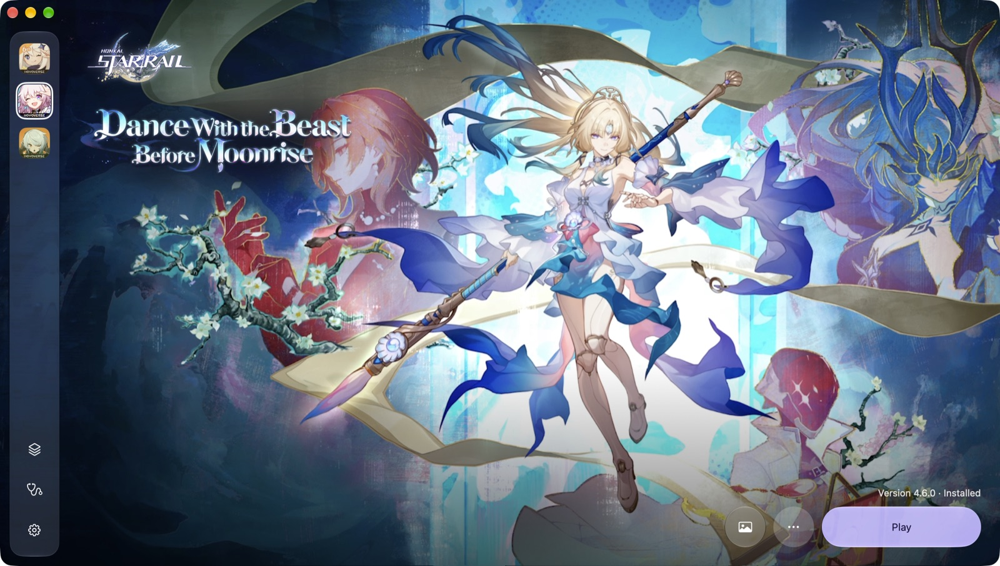
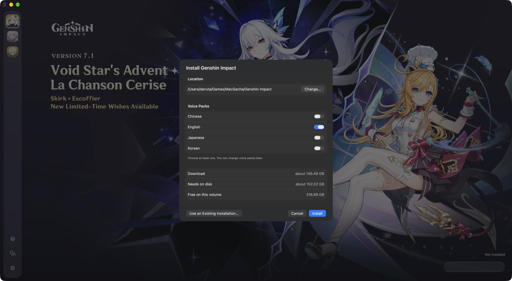
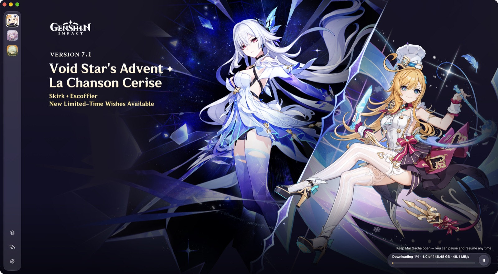
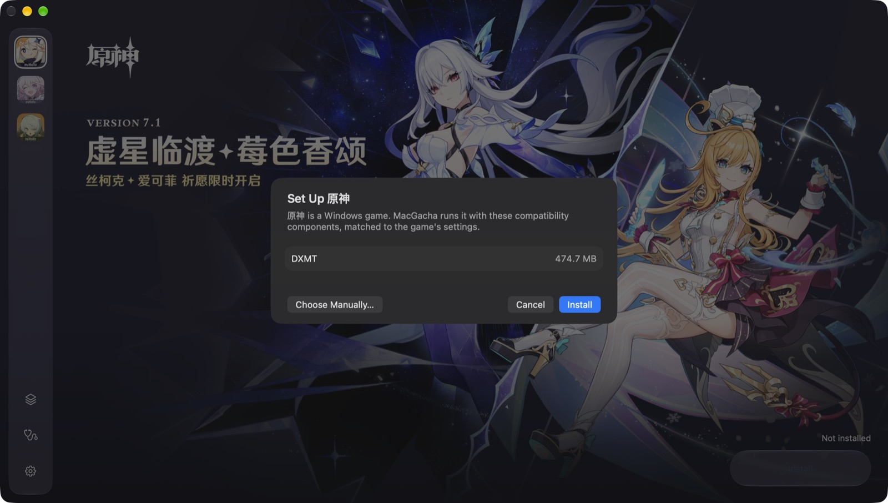
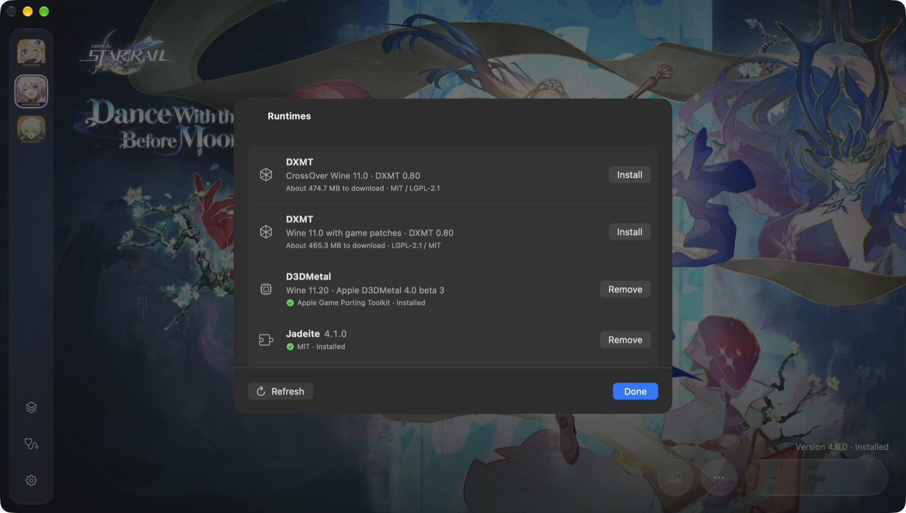
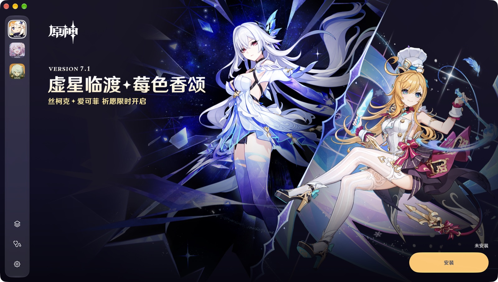

# MacGacha — universal launcher for HoYoverse games on Apple Silicon

> 🧪 **Beta.** [MacGacha 0.1.0 beta](https://github.com/deruta74/MacGacha/releases/tag/v0.1.0-beta) is out: install, update and play all three games with one click. Expect rough edges, and please [report what you find](#feedback).

A native macOS launcher for **Genshin Impact**, **Honkai: Star Rail** and **Zenless Zone Zero** on Apple Silicon. It aims to provide reliable resumable downloads, file verification, and managed Wine / DXMT / D3DMetal runtimes.

- Requirements: Apple Silicon Mac with Rosetta 2 (MacGacha offers to install it), macOS 27 or later.

Code and documentation in this repository may be written or modified with assistance from large language models (LLMs) and AI agents. The software is provided under the [GPL-3.0 license](LICENSE), as is, without warranty.

## Install

1. Download `MacGacha-<version>.dmg` from [Releases](https://github.com/deruta74/MacGacha/releases), open it and drag **MacGacha** to **Applications**.
2. Open MacGacha. MacGacha isn't signed or notarized by Apple, so macOS says it can't verify the developer. Click **Done**.
3. Open **System Settings → Privacy & Security**, scroll down to the MacGacha message and click **Open Anyway**, then confirm.

If there's no **Open Anyway** button, or macOS still refuses to open the app, remove the download quarantine flag in Terminal and open MacGacha again:

```bash
xattr -dr com.apple.quarantine /Applications/MacGacha.app
```

This only changes MacGacha itself, not any system setting. The first launch can take a while as macOS checks the app.

## Screenshots



| Install | Downloading |
|---|---|
|  |  |

| One-click setup | Runtimes |
|---|---|
|  |  |



## Roadmap

**Done**
- **Automatic updates** (Sparkle). **Check for Updates…** in the MacGacha menu and a switch in Settings. MacGacha asks before it downloads an update and installs it only when no game, recovery or installation is running.
- **Download engine.** Resumable, verified downloads with a crash-safe journal. A file reaches the game folder only after its hash matches. Files are downloaded and assembled in parallel, close to the full speed of a 2.5 Gbit link.
- **Installing games** through HoYoverse's official delivery: install, update, verify and repair, voice packs, using an existing installation, and uninstall. Pause and resume work across app restarts. Free space is checked before and during the download. If macOS is still holding space (Time Machine snapshots, caches), the launcher says so instead of just "not enough space".
- **Runtimes.** Wine, DXMT and D3DMetal are downloaded and kept side by side, so an update never breaks a working version. D3DMetal is installed only after you accept Apple's terms, or imported from an existing Game Porting Toolkit. The default DXMT build now uses CrossOver's Wine, which needs about 2.5× less CPU than the previous one.
- **Compatibility components.** jadeite and a Steam launcher shim are installed and removed from the Runtimes window. We build the shim ourselves, reproducibly, from Valve's Proton source ([release](https://github.com/deruta74/MacGacha/releases/tag/steam-shim-proton-10.0-4)).
- **Launcher.** One window for all three games with the official banners and background art, plus a diagnostics bundle for bug reports.
- **One-click Play.** Press Play, and the launcher prepares the Wine prefix and the compatibility workaround, starts the game and minimizes itself to the Dock. When the game closes, it comes back and puts back any game files it hid. Accepted in all three games on D3DMetal and DXMT.
- **One-click setup.** When a game needs runtimes, "Set Up…" lists exactly what it needs for its settings (the Wine bundle and its compatibility component) and installs it all in one go, asking for Apple's terms only when D3DMetal is part of it. The Runtimes panel stays available for picking versions by hand.
- **Per-game settings:** graphics backend, frame limit, Retina mode, DirectX 12 for Zenless Zone Zero, and a switch for the compatibility workaround.
- **Recovery.** If the launcher crashes or is quit while a game runs, it finds the game again on restart and restores everything once the game exits. Quitting during a game asks first.
- **Privacy.** Games run in their own Wine prefix with no links to your Desktop, Documents or other home folders. Session logs stay on your Mac and can be turned off in Settings.
- **Languages.** English and Simplified Chinese interface. Game news and art follow the interface language.

**Verified by hand (macOS 27.0.1)**

All three games start and play with a community anti-cheat workaround. None of them needs `/etc/hosts` changes or administrator rights. Measured on a MacBook Pro 14″ with M5 Pro (48 GB) and on a base M5 (16 GB). Zenless Zone Zero used the same graphics preset on both.

| Game | Default backend | M5 Pro, 48 GB | M5, 16 GB |
|---|---|---|---|
| Honkai: Star Rail 4.6 | D3DMetal, 60 fps cap | 60 fps on Ultra. About half the CPU of DXMT, GPU time about 6.5 ms against 9 ms. | Not measured yet. |
| Zenless Zone Zero | D3DMetal, DirectX 12 | 120 fps on High, battle dips stay above 115. With ray tracing on Low, 70–90 fps. | 70–110 fps on High in battle, depending on how many enemies and effects are on screen. With ray tracing on Low, 50–60 fps. |
| Genshin Impact 7.1 | D3DMetal, 60 fps cap | Steady 60 fps on Ultra at 1800×1169 with render scale 1.2, even frame time. | 60 fps at 1512×982 with render scale 1.2. |

DXMT works for every game and stays available as the open-source alternative. The 60 fps cap fixes uneven frame pacing in Star Rail and Genshin, and it can be changed per game.

**In progress**
- **Mainland China editions (beta).** A region switch in Settings shows 原神, 崩坏：星穹铁道 and 绝区零 with their own installs, prefixes and settings. 绝区零 installs from the miHoYo servers and runs past the login screen with our [Wine crypt32 fix](https://github.com/deruta74/MacGacha/releases/tag/crypt32-fix-wine-11.20-1). 原神 and 崩坏：星穹铁道 still need in-game testing, and login hasn't been tested on any mainland edition. Testers with mainland accounts are welcome.
- **Star Rail's in-game hotfix restart**, which hasn't been tested yet.
- **Interface in every HoYoPlay language.** Besides English and Simplified Chinese: Traditional Chinese, Japanese, Korean, Russian, German, French, Spanish, Portuguese, Indonesian, Thai and Vietnamese. Game news and art already follow the interface language.

**Next**
1. **Wine 11.21 runtime**, which has the crypt32 fix built in. Our separate fix then goes away.
2. **Display choice.** Pick the monitor a game opens on, the main display by default.
3. **FPS unlocker (opt-in)** for games capped at 60 fps, off by default, with a ban-risk warning before you enable it.
4. **Downloads.** Estimated time remaining and pre-downloading the next version before release.
5. **Rotating banners and news** like HoYoPlay.
6. **Audio.** Surround output, including Spatial Audio on AirPods.

## Feedback

Found a bug or have an idea? [Open an issue](https://github.com/deruta74/MacGacha/issues) and say what you did and what happened, with your Mac model, macOS version, the game and its graphics backend. For problems with installing or launching, attach a diagnostics bundle: **Diagnostics** in the sidebar → **Export Diagnostic Bundle…**. It removes paths and tokens.

## Is it safe?

Use at your own risk. To run under Wine, MacGacha uses community anti-cheat workarounds (jadeite, a Steam launcher shim). They may conflict with HoYoverse's Terms of Service, and a ban is possible, even if unlikely. If you're worried, try it first with a new free-to-play account.

By default MacGacha downloads games only from HoYoverse's official servers and verifies every file. It doesn't change the game process, never edits `/etc/hosts` and never asks for your password. Each game runs in its own Wine prefix with no access to your Desktop or Documents.

Optional features that do change the game process, such as an FPS unlocker, are **off by default**. Before you turn one on, MacGacha warns you about the extra ban risk.

## Disclaimer

MacGacha is an unofficial, community project. It is not affiliated with, endorsed by, or supported by HoYoverse (COGNOSPHERE) or Apple Inc. All game names and trademarks belong to their respective owners.

- Using third-party launchers may conflict with HoYoverse's Terms of Service. Use at your own risk.
- Under Wine, the games' anti-cheat stops them from starting. To launch them, MacGacha uses community workarounds: [jadeite](https://codeberg.org/mkrsym1/jadeite) for Star Rail, which also blocks one game server through a local proxy while the game runs, and a Steam launcher shim for Genshin Impact and Zenless Zone Zero. These workarounds may conflict with the Terms of Service and could lead to an account ban. By default, MacGacha doesn't change the game process. Optional features that do, such as an FPS unlocker, are off by default, and MacGacha warns you about the ban risk before you enable them.
- The software is provided as is. The authors aren't responsible for account bans, data loss or any other damage.
- D3DMetal and the Game Porting Toolkit are © Apple Inc. and licensed under Apple's terms. The launcher will ask you to accept those terms before it downloads the component.

## Related projects

- [DXMT](https://github.com/3Shain/dxmt): a Metal-based Direct3D 11 translation layer, one of MacGacha's two graphics backends.
- [jadeite](https://codeberg.org/mkrsym1/jadeite): the anti-cheat workaround MacGacha uses for Star Rail.

## Special thanks

- The [Wine](https://www.winehq.org) project, and CodeWeavers for CrossOver's open-source Wine.
- 3Shain for DXMT and yaagl, whose launch research MacGacha builds on.
- dbc-hbin for the Wine 11.20 + D3DMetal builds.
- mkrsym1 for jadeite.
- Valve for Proton, the source of our Steam launcher shim.
- an-anime-team, whose bug tracker traced the Mainland China crash ([AAGL #572](https://github.com/an-anime-team/an-anime-game-launcher/issues/572)), and Michael Nelson for the upstream Wine fix ([MR 11824](https://gitlab.winehq.org/wine/wine/-/merge_requests/11824)).
- Apple for D3DMetal and the Game Porting Toolkit.

## License

Copyright (C) 2026 deruta74. MacGacha is free software under the [GNU General Public License v3.0](LICENSE), with one additional term under GPL section 7(b) (see [NOTICE](NOTICE)): the link to the original project, https://github.com/deruta74/MacGacha, must be kept by every conveyed (distributed) copy and every distributed work based on MacGacha, both in its source and in its About screen. Private modifications that aren't distributed aren't affected. Any distributed version, modified or paid, must stay under GPL-3.0 with its source available.

Components the launcher downloads at runtime (Wine, DXMT, D3DMetal, jadeite, the Steam shim) and the games themselves are under their own licenses and terms.
