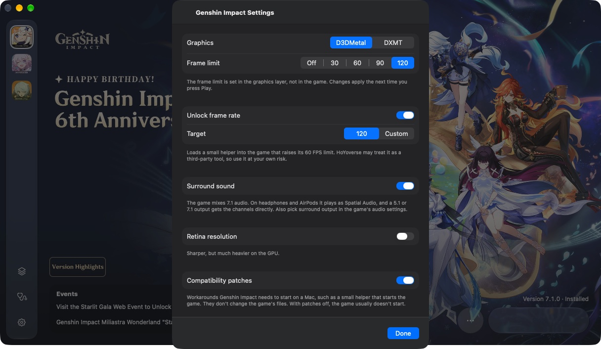
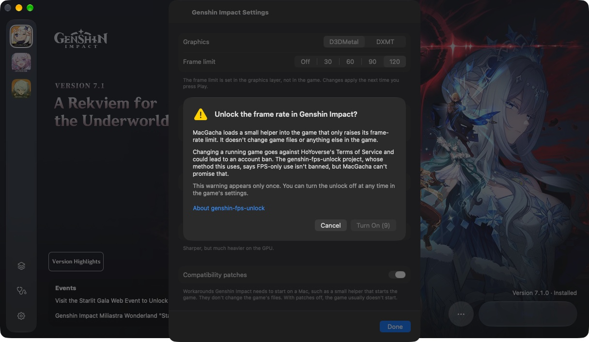
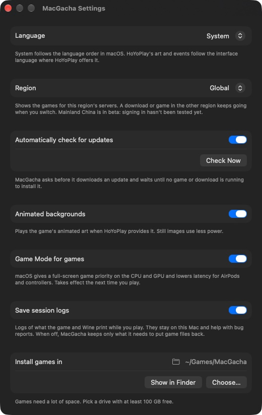

# MacGacha — universeller Launcher für HoYoverse-Spiele auf Apple Silicon

[](../README.md)
[](README.ru.md)
[](README.uk.md)
[](README.de.md)
[](README.fr.md)
[](README.zh-CN.md)
[](README.ja.md)

> ✨ **[MacGacha 0.2.0](https://github.com/deruta74/MacGacha/releases/tag/v0.2.0) ist da**, die erste Veröffentlichung ohne Beta-Zusatz: 14 Sprachen, Hintergründe und Events im Stil von HoYoPlay, Freischaltung der Bildrate in Genshin Impact, Star Rail mit 120 FPS, Surround-Sound mit 3D-Audio und Spielmodus. Du nutzt bereits 0.1.x? MacGacha aktualisiert sich selbst. Etwas entdeckt? Bitte [melde es](#feedback).

Ein nativer macOS-Launcher für **Genshin Impact**, **Honkai: Star Rail** und **Zenless Zone Zero** auf Apple Silicon. Er installiert, aktualisiert und überprüft die Spiele über die offiziellen Server von HoYoverse, verwaltet Wine / DXMT / D3DMetal und startet jedes Spiel mit einem Klick.

- Voraussetzungen: Mac mit Apple Silicon und Rosetta 2 (MacGacha bietet die Installation an), macOS 27 oder neuer.

Code und Dokumentation in diesem Repository können mithilfe großer Sprachmodelle (LLMs) und KI-Agenten geschrieben oder geändert werden. Die Software wird unter der [GPL-3.0-Lizenz](../LICENSE) im vorliegenden Zustand und ohne Gewährleistung bereitgestellt.

## Installation

1. Lade `MacGacha-<version>.dmg` unter [Releases](https://github.com/deruta74/MacGacha/releases) herunter, öffne die Datei und ziehe **MacGacha** in **Programme**.
2. Öffne MacGacha. Die App ist nicht von Apple signiert oder notarisiert, daher meldet macOS, dass der Entwickler nicht überprüft werden kann. Klicke auf **Fertig**.
3. Öffne **Systemeinstellungen → Datenschutz & Sicherheit**, scrolle zur Meldung über MacGacha und klicke auf **Dennoch öffnen**. Bestätige anschließend.

Falls **Dennoch öffnen** nicht angezeigt wird oder macOS die App weiterhin nicht öffnet, entferne im Terminal das Quarantäneattribut des Downloads und öffne MacGacha erneut:

```bash
xattr -dr com.apple.quarantine /Applications/MacGacha.app
```

Das ändert nur MacGacha selbst, keine Systemeinstellung. Der erste Start kann etwas dauern, während macOS die App überprüft.

Spätere Versionen erhältst du über **Nach Aktualisierungen suchen …** im MacGacha-Menü. Diese Schritte sind daher nur einmal nötig.

## Screenshots


| Spieleinstellungen | Warnung zur Freischaltung der Bildrate |
|---|---|
|  |  |

| Installation | Download |
|---|---|
|  |  |

| Einrichtung mit einem Klick | Festlandchina |
|---|---|
|  |  |

<p align="center"></p>

## Roadmap

**Abgeschlossen**

- **Spielen mit einem Klick.** Klicke auf „Spiel starten“: Der Launcher bereitet das Wine-Präfix und die Kompatibilitätsumgehung vor, startet das Spiel und minimiert sich ins Dock. Nach dem Beenden des Spiels kehrt er zurück und stellt alle zuvor ausgeblendeten Spieldateien wieder her. Für alle drei Spiele mit D3DMetal und DXMT getestet und abgenommen.
- **Spielinstallation** über das offizielle Auslieferungssystem von HoYoverse: Installieren, Aktualisieren, Überprüfen und Reparieren, Sprachpakete, Einbinden einer vorhandenen Installation und Deinstallieren. Pausieren und Fortsetzen funktionieren auch über App-Neustarts hinweg. Der freie Speicher wird vor und während des Downloads geprüft. Hält macOS noch Speicher belegt (Time-Machine-Snapshots, Caches), erklärt der Launcher dies, statt nur „Nicht genügend Speicherplatz“ zu melden. **Nach Aktualisierungen suchen** im Spielmenü sucht sofort nach einer neuen Version.
- **Download-Engine.** Fortsetzbare, überprüfte Downloads mit absturzsicherem Journal. Eine Datei gelangt erst nach erfolgreichem Hashvergleich in den Spielordner. Dateien werden parallel heruntergeladen und zusammengesetzt, mit nahezu voller Geschwindigkeit einer 2,5-Gbit/s-Verbindung. Downloads und vollständige Überprüfungen zeigen die Restzeit an; bei langen Schritten wird die bisherige Dauer angezeigt.
- **Launcher.** Ein Fenster für alle drei Spiele mit HoYoPlay-Hintergründen in der Reihenfolge von HoYoPlay. Bei jedem Öffnen von MacGacha erscheint der nächste Hintergrund; über die Punkte oben wechselst du zwischen ihnen. Animierte Hintergründe laufen im eigenen Videoplayer von MacGacha, der etwa ein Drittel weniger Arbeitsspeicher als eine Webansicht benötigt. Die Versionshighlights jedes Hintergrunds und die aktuellen HoYoPlay-Events öffnen sich im Browser.
- **Freischaltung der Bildrate in Genshin Impact (optional).** Ein standardmäßig deaktivierter Schalter in den Genshin-Einstellungen mit einem Ziel von 120 FPS oder einem eigenen Wert bis 360. MacGacha lädt ein kleines Hilfsmodul in das Spiel, das ausschließlich dessen Bildratenlimit anhebt. Es nutzt die Methode von [genshin-fps-unlock](https://github.com/34736384/genshin-fps-unlock). Wir erstellen es selbst und reproduzierbar ([Release](https://github.com/deruta74/MacGacha/releases/tag/genshin-fps-unlock-2)). Beim ersten Aktivieren erklärt eine Warnung das Risiko einer Kontosperre. Getestet mit der globalen Version von Genshin 7.1: stabile 120 FPS über eine 3,5-stündige Online-Sitzung.
- **Star Rail mit 120 FPS.** Ein Schalter in den Star-Rail-Einstellungen für Global und Festlandchina setzt vor jedem Start die im Spiel gespeicherte Bildrate auf 120. Ändere nach einer Neuinstallation einmal eine beliebige Grafikoption im Spiel, damit es seine Einstellungen speichert, und starte es danach erneut.
- **Surround-Sound.** Genshin Impact und Zenless Zone Zero können mit D3DMetal Surround-Sound ausgeben, der für AirPods und andere unterstützte Kopfhörer in 3D-Audio gemischt wird. Lautsprecher mit sechs oder mehr Kanälen behalten ihre eigene Kanalbelegung. Standardmäßig deaktiviert, mit einem Schalter pro Spiel.
- **Spielmodus.** macOS aktiviert den Spielmodus für die Spiele, nicht für den Launcher. Jedes Spiel läuft als eigene App mit Namen und Symbol, damit macOS es erkennt. Mit D3DMetal und DXMT bestätigt. In den Einstellungen lässt sich der Modus deaktivieren.
- **Einstellungen pro Spiel:** Grafik-Backend, Bildratenlimit (Aus, 30, 60, 90 oder 120), Bildschirm, Retina-Modus, DirectX 12 für Zenless Zone Zero und ein Schalter für die Kompatibilitätsumgehung.
- **Laufzeitumgebungen.** Wine, DXMT und D3DMetal werden heruntergeladen und nebeneinander aufbewahrt, sodass ein Update keine funktionierende Version ersetzt. D3DMetal wird erst nach Annahme der Apple-Bedingungen installiert oder aus einem vorhandenen Game Porting Toolkit importiert. Der standardmäßige DXMT-Build nutzt Wine aus CrossOver und benötigt etwa 2,5-mal weniger CPU-Ressourcen als der vorherige.
- **Einrichtung mit einem Klick.** Benötigt ein Spiel Laufzeitumgebungen, listet „Einrichten …“ die für seine Einstellungen erforderlichen Komponenten auf und installiert alles in einem Durchgang. Die Apple-Bedingungen werden nur abgefragt, wenn D3DMetal dazugehört. Im Bereich „Laufzeitumgebungen“ können Versionen weiterhin manuell ausgewählt werden.
- **Kompatibilitätskomponenten.** jadeite und ein Steam-Launcher-Shim werden im Fenster für Laufzeitumgebungen installiert und entfernt. Wir bauen den Shim selbst und reproduzierbar aus Valves Proton-Quellcode ([Release](https://github.com/deruta74/MacGacha/releases/tag/steam-shim-proton-10.0-4)).
- **Sprachen.** Die Oberfläche ist auf Englisch, vereinfachtem und traditionellem Chinesisch, Japanisch, Koreanisch, Russisch, Ukrainisch, Deutsch, Französisch, Spanisch, Portugiesisch, Indonesisch, Thai und Vietnamesisch verfügbar. Sie folgt der Sprachreihenfolge deines Mac; alternativ wählst du eine Sprache in den Einstellungen. Spielnachrichten und Grafiken folgen der Oberflächensprache (Englisch bei Ukrainisch, das HoYoPlay nicht anbietet). Ein Sprachwechsel startet MacGacha neu; ein laufender Download wird automatisch fortgesetzt.
- **Automatische Updates** (Sparkle). **Nach Aktualisierungen suchen …** im MacGacha-Menü und ein Schalter in den Einstellungen. MacGacha fragt vor dem Herunterladen eines Updates und installiert es nur, wenn weder ein Spiel noch eine Wiederherstellung oder Installation läuft. Das Updatefenster zeigt die Änderungen an.
- **Wiederherstellung.** Stürzt der Launcher ab oder wird er während eines Spiels beendet, findet er das Spiel beim nächsten Start wieder und stellt nach dessen Ende alles wieder her. Beim Beenden während eines laufenden Spiels wird zuvor nachgefragt.
- **Datenschutz.** Spiele laufen in eigenen Wine-Präfixen ohne Verknüpfungen zu Schreibtisch, Dokumenten oder anderen Benutzerordnern. Sitzungsprotokolle bleiben auf deinem Mac und können in den Einstellungen deaktiviert werden. Aus Diagnosepaketen für Fehlerberichte werden Pfade und Tokens entfernt.

**Manuell überprüft (macOS 27.0.1)**

Alle drei Spiele starten und laufen mit einer Anti-Cheat-Umgehung aus der Community. Keines benötigt Änderungen an `/etc/hosts` oder Administratorrechte. Gemessen auf einem MacBook Pro 14″ mit M5 Pro (48 GB) und einem Basismodell mit M5 (16 GB). Zenless Zone Zero verwendete auf beiden dasselbe Grafikpreset.

| Spiel | Standard-Backend | M5 Pro, 48 GB | M5, 16 GB |
|---|---|---|---|
| Honkai: Star Rail 4.6 | D3DMetal, Limit 60 FPS | 60 FPS auf Ultra. Etwa halb so viel CPU-Last wie DXMT, GPU-Zeit etwa 6,5 ms statt 9 ms. | Noch nicht gemessen. |
| Zenless Zone Zero | D3DMetal, DirectX 12 | 120 FPS auf Hoch, Einbrüche im Kampf bleiben über 115. Mit Raytracing auf Niedrig: 70–90 FPS. | 70–110 FPS auf Hoch im Kampf, abhängig von Gegnern und Effekten auf dem Bildschirm. Mit Raytracing auf Niedrig: 50–60 FPS. |
| Genshin Impact 7.1 | D3DMetal, Limit 60 FPS | Stabile 60 FPS auf Ultra bei 1800×1169 und Renderauflösung 1,2, gleichmäßige Framezeiten. Mit freigeschalteter Bildrate: 120 FPS. | 60 FPS bei 1512×982 und Renderauflösung 1,2. |

DXMT funktioniert mit jedem Spiel und bleibt als Open-Source-Alternative verfügbar. Das Limit von 60 FPS beseitigt ungleichmäßige Framezeiten in Star Rail und Genshin und kann pro Spiel geändert werden.

**In Arbeit**

- **Versionen für Festlandchina (Beta).** Ein Regionsschalter in den Einstellungen zeigt 原神, 崩坏：星穹铁道 und 绝区零 mit eigenen Installationen, Präfixen und Einstellungen. 绝区零 lässt sich von den miHoYo-Servern installieren und läuft mit unserem [Wine-crypt32-Fix](https://github.com/deruta74/MacGacha/releases/tag/crypt32-fix-wine-11.20-1) über den Anmeldebildschirm hinaus. 原神 und 崩坏：星穹铁道 müssen noch im Spiel getestet werden; die Anmeldung wurde bei keiner Festlandchina-Version geprüft. Tester mit entsprechenden Konten sind willkommen.
- **Neustart nach einem Hotfix innerhalb von Star Rail**, der noch nicht getestet wurde.

**Als Nächstes**

1. **Wine-11.21-Laufzeitumgebung** mit integriertem crypt32-Fix. Unser separater Fix entfällt dann.
2. **Vorabdownload.** Die nächste Version schon vor ihrer Veröffentlichung herunterladen.
3. **Head-Tracking für 3D-Audio.** Kopfhörerbewegungen bei räumlicher Wiedergabe berücksichtigen.

<a id="feedback"></a>

## Feedback

Einen Fehler gefunden oder eine Idee? [Erstelle ein Issue](https://github.com/deruta74/MacGacha/issues) und beschreibe deine Schritte und das Ergebnis, dein Mac-Modell, die macOS-Version, das Spiel und dessen Grafik-Backend. Bei Installations- oder Startproblemen hänge ein Diagnosepaket an: **Diagnose** in der Seitenleiste → **Diagnosepaket exportieren …**. Pfade und Tokens werden daraus entfernt.

## Ist das sicher?

Die Nutzung erfolgt auf eigenes Risiko. Damit Spiele unter Wine laufen, verwendet MacGacha Anti-Cheat-Umgehungen aus der Community (jadeite, Steam-Launcher-Shim). Das kann gegen die Nutzungsbedingungen von HoYoverse verstoßen; eine Kontosperre ist möglich, wenn auch unwahrscheinlich. Wenn du Bedenken hast, teste zuerst mit einem neuen kostenlosen Konto.

Standardmäßig lädt MacGacha Spiele nur von den offiziellen HoYoverse-Servern und überprüft jede Datei. Es verändert den Spielprozess nicht, bearbeitet niemals `/etc/hosts` und fragt nie nach deinem Passwort. Jedes Spiel läuft in einem eigenen Wine-Präfix ohne Zugriff auf Schreibtisch oder Dokumente. Optionale Funktionen, die den Spielprozess verändern, etwa die Freischaltung der Bildrate in Genshin Impact, sind **standardmäßig deaktiviert**. Vor dem ersten Aktivieren warnt MacGacha vor dem zusätzlichen Sperrrisiko.

## Haftungsausschluss

MacGacha ist ein inoffizielles Community-Projekt. Es ist weder mit HoYoverse (COGNOSPHERE) oder Apple Inc. verbunden noch wird es von diesen unterstützt oder empfohlen. Alle Spielnamen und Marken gehören ihren jeweiligen Eigentümern.

- Die Nutzung von Drittanbieter-Launchern kann gegen die Nutzungsbedingungen von HoYoverse verstoßen. Nutzung auf eigenes Risiko.
- Unter Wine verhindert der Anti-Cheat-Schutz den Start der Spiele. MacGacha nutzt dafür Community-Umgehungen: [jadeite](https://codeberg.org/mkrsym1/jadeite) für Star Rail und zusätzlich die Sperrung eines Spielservers über einen lokalen Proxy während des Spiels sowie einen Steam-Launcher-Shim für Genshin Impact und Zenless Zone Zero. Diese Umgehungen können gegen die Nutzungsbedingungen verstoßen und zu einer Kontosperre führen. Standardmäßig verändert MacGacha den Spielprozess nicht. Optionale Funktionen wie die Freischaltung der Bildrate in Genshin Impact tun dies, sind aber standardmäßig deaktiviert; vor ihrer Aktivierung warnt MacGacha vor dem Sperrrisiko.
- Die Software wird im vorliegenden Zustand bereitgestellt. Die Autoren haften nicht für Kontosperren, Datenverlust oder sonstige Schäden.
- D3DMetal und Game Porting Toolkit sind © Apple Inc. und unterliegen den Bedingungen von Apple. Der Launcher fordert dich vor dem Herunterladen der Komponente auf, diese Bedingungen anzunehmen.

## Verwandte Projekte

- [DXMT](https://github.com/3Shain/dxmt): eine Metal-basierte Übersetzungsschicht für Direct3D 11 und eines der beiden Grafik-Backends von MacGacha.
- [jadeite](https://codeberg.org/mkrsym1/jadeite): die Anti-Cheat-Umgehung, die MacGacha für Star Rail verwendet.
- [genshin-fps-unlock](https://github.com/34736384/genshin-fps-unlock): ein Werkzeug zum Freischalten der Bildrate, dessen Methode MacGacha für Genshin Impact nutzt.

## Besonderer Dank

- Dem [Wine](https://www.winehq.org)-Projekt und CodeWeavers für den offenen Wine-Quellcode von CrossOver.
- 3Shain für DXMT und yaagl, auf dessen Untersuchungen zum Spielstart MacGacha aufbaut.
- dbc-hbin für die Builds von Wine 11.20 + D3DMetal.
- mkrsym1 für jadeite.
- 34736384 für [genshin-fps-unlock](https://github.com/34736384/genshin-fps-unlock), dessen Methode unsere Bildratenfreischaltung für Genshin Impact verwendet.
- Valve für Proton, aus dessen Quellcode unser Steam-Launcher-Shim stammt.
- an-anime-team, über dessen Bugtracker die Ursache des Absturzes der Festlandchina-Version gefunden wurde ([AAGL #572](https://github.com/an-anime-team/an-anime-game-launcher/issues/572)), und Michael Nelson für den Fix im Wine-Hauptprojekt ([MR 11824](https://gitlab.winehq.org/wine/wine/-/merge_requests/11824)).
- Apple für D3DMetal und Game Porting Toolkit.

## Lizenz

Copyright (C) 2026 deruta74. MacGacha ist freie Software unter der [GNU General Public License v3.0](../LICENSE) mit einer zusätzlichen Bedingung gemäß GPL-Abschnitt 7(b) (siehe [NOTICE](../NOTICE)): Der Link zum Originalprojekt, https://github.com/deruta74/MacGacha, muss in jeder weitergegebenen (verbreiteten) Kopie und in jedem verbreiteten Werk auf Grundlage von MacGacha erhalten bleiben, sowohl im Quellcode als auch im Infofenster. Private Änderungen, die nicht verbreitet werden, sind davon nicht betroffen. Jede verbreitete Version, ob verändert oder kostenpflichtig, muss unter GPL-3.0 bleiben und ihren Quellcode zugänglich machen.

Komponenten, die der Launcher zur Laufzeit herunterlädt (Wine, DXMT, D3DMetal, jadeite, der Steam-Shim, das Surround-Audio-Modul und das Genshin-Hilfsmodul für die Bildrate), sowie die Spiele selbst unterliegen ihren eigenen Lizenzen und Bedingungen.
