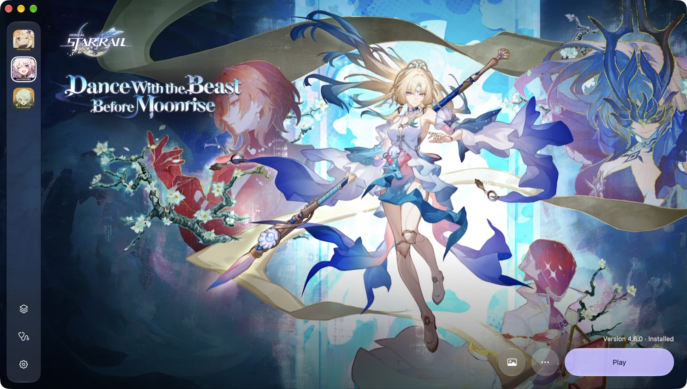
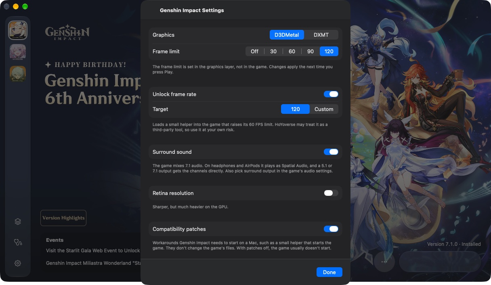
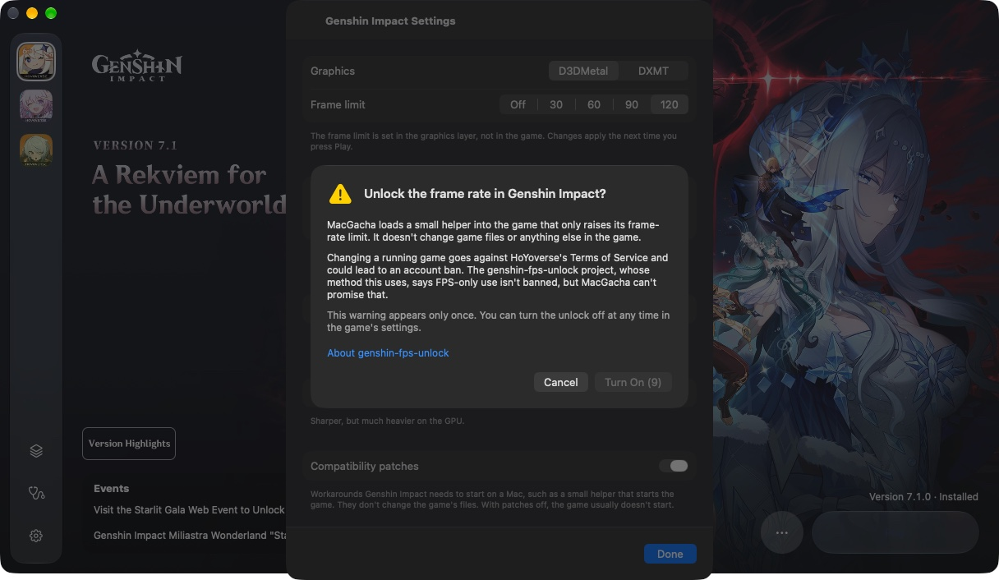
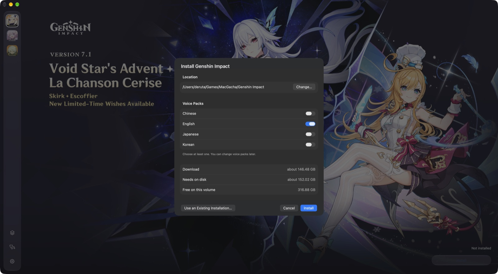
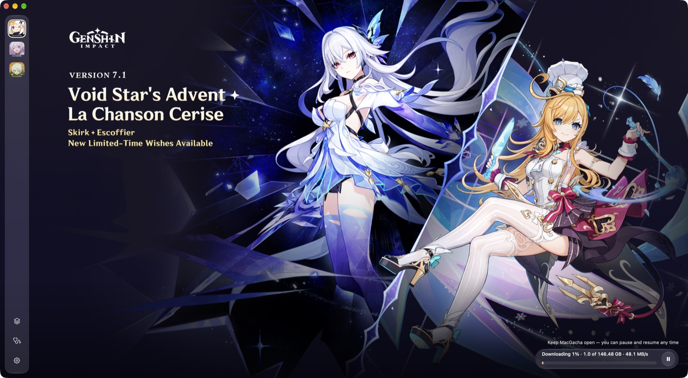
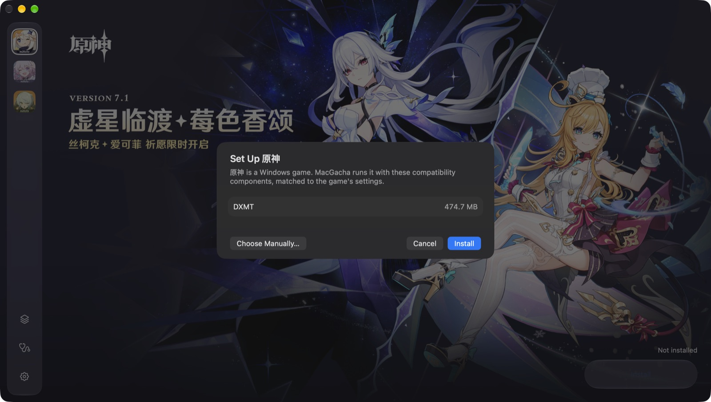
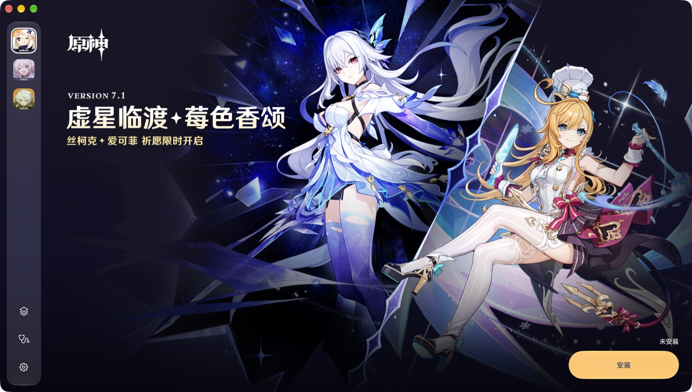
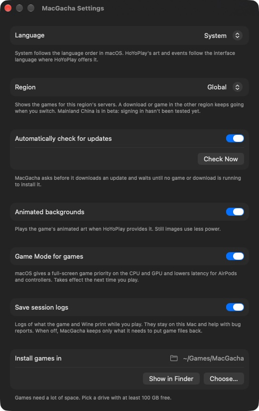

# MacGacha — lanceur universel de jeux HoYoverse sur Apple Silicon

[](../README.md)
[](README.ru.md)
[](README.uk.md)
[](README.de.md)
[](README.fr.md)
[](README.zh-CN.md)
[](README.ja.md)

> ✨ **[MacGacha 0.3.5](https://github.com/deruta74/MacGacha/releases/tag/v0.3.5) est disponible** : installation et mise à jour automatique de l'éditeur Miliastra Sandbox de Genshin Impact, un message clair quand votre réseau bloque les serveurs du jeu et la vidéo d'arrière-plan ne s'accélère plus. Vous utilisez déjà la version 0.3.1 ? MacGacha se met à jour automatiquement. Vous avez remarqué un problème ? [Signalez-le](#feedback).

Un lanceur macOS natif pour **Genshin Impact**, **Honkai: Star Rail**, **Zenless Zone Zero** et **Honkai Impact 3rd** sur Apple Silicon. Il installe, met à jour et vérifie les jeux depuis les serveurs officiels de HoYoverse, gère les environnements Wine / DXMT / D3DMetal et lance chaque jeu en un clic.

- Configuration requise : un Mac avec Apple Silicon et Rosetta 2 (MacGacha propose de l’installer), sous macOS 27 ou version ultérieure.

Le code et la documentation de ce dépôt peuvent être rédigés ou modifiés avec l’aide de grands modèles de langage (LLM) et d’agents d’IA. Le logiciel est fourni sous [licence GPL-3.0](../LICENSE), en l’état, sans garantie.

Genshin Impact et Zenless Zone Zero utilisent un profil Windows 11 dans Wine pour Global et la Chine continentale. Les préfixes existants sont mis à jour automatiquement avant le lancement. Ce correctif a été vérifié avec Global Genshin 7.2 sous DXMT et D3DMetal, et Global ZZZ 3.3 sous D3DMetal. Un testeur a joué à Genshin 7.2 de Chine continentale avec D3DMetal et un compte de cette région. Le fonctionnement en jeu de ZZZ pour la Chine continentale reste à vérifier.

## Installation

1. Téléchargez `MacGacha-<version>.dmg` depuis les [versions publiées](https://github.com/deruta74/MacGacha/releases), ouvrez le fichier et faites glisser **MacGacha** dans **Applications**.
2. Ouvrez MacGacha. L’application n’est ni signée ni notariée par Apple. macOS indique donc qu’il ne peut pas vérifier le développeur. Cliquez sur **Terminé**.
3. Ouvrez **Réglages Système → Confidentialité et sécurité**, faites défiler jusqu’au message concernant MacGacha et cliquez sur **Ouvrir quand même**, puis confirmez.

Si le bouton **Ouvrir quand même** n’apparaît pas, ou si macOS refuse toujours d’ouvrir l’application, retirez l’attribut de quarantaine du téléchargement dans Terminal, puis ouvrez à nouveau MacGacha :

```bash
xattr -dr com.apple.quarantine /Applications/MacGacha.app
```

Cette commande ne modifie que MacGacha, aucun réglage système. Le premier lancement peut prendre un peu de temps pendant que macOS vérifie l’application.

Les versions suivantes sont proposées via **Rechercher les mises à jour…** dans le menu MacGacha. Cette procédure n’est donc nécessaire qu’une fois.

## Captures d’écran



| Réglages du jeu | Avertissement sur le déblocage de la fréquence d’images |
|---|---|
|  |  |

| Installation | Téléchargement |
|---|---|
|  |  |

| Configuration en un clic | Chine continentale |
|---|---|
|  |  |

<p align="center"></p>

## Feuille de route

**Terminé**

- **Honkai Impact 3rd Global (Europe et Amériques).** MacGacha installe, met à jour, vérifie, répare et lance la version Windows. Il peut aussi reprendre une installation existante. Le propriétaire du projet a testé le jeu en version 9.1.0 avec Wine 11.22 et D3DMetal, le moteur graphique recommandé. DXMT est disponible et reste à valider en jeu.
- Le catalogue mondial propose la préinscription à Petit Planet et à Honkai: Nexus Anima.
- **Démarrer en un clic.** Cliquez sur « Démarrer » : le lanceur prépare le préfixe Wine et le contournement de compatibilité, démarre le jeu et se réduit dans le Dock. À la fermeture du jeu, il réapparaît et remet en place les fichiers du jeu qu’il avait masqués. Genshin Impact, Honkai: Star Rail et Zenless Zone Zero ont été validés avec D3DMetal et DXMT.
- **Installation des jeux** via le système officiel de distribution de HoYoverse : installation, mise à jour, vérification et réparation, packs de voix, utilisation d’une installation existante et désinstallation. La pause et la reprise fonctionnent même après un redémarrage de l’application. L’espace libre est vérifié avant et pendant le téléchargement. Si macOS retient encore de l’espace (instantanés Time Machine, caches), le lanceur l’explique au lieu d’indiquer seulement « espace insuffisant ». **Rechercher les mises à jour** dans le menu d’un jeu cherche immédiatement une nouvelle version.
- **Mises à jour plus légères et pré-téléchargement.** Genshin Impact et Honkai: Star Rail se mettent à jour avec les fichiers de correctif de HoYoverse, comme dans HoYoPlay. La mise à jour de Genshin 7.1 vers 7.2 avec les voix anglaises fait 8,4 Go au lieu de 22,7 Go. Lorsque HoYoverse propose la prochaine version à l’avance, le **pré-téléchargement** la télécharge avant sa sortie, et la version installée reste jouable. Appuyer sur « Démarrer » met le pré-téléchargement en pause, et vous le reprenez après avoir joué. Le jour de la sortie, la mise à jour s’installe à partir de ces fichiers. Un fichier qui ne peut pas être corrigé est téléchargé normalement.
- **Moteur de téléchargement.** Téléchargements vérifiés et pouvant être repris, avec un journal résistant aux plantages. Un fichier n’arrive dans le dossier du jeu qu’après validation de son empreinte. Les fichiers sont téléchargés et assemblés en parallèle, à une vitesse proche du débit maximal d’une connexion à 2,5 Gbit/s. Les téléchargements et vérifications complètes affichent le temps restant. Les étapes longues affichent leur durée écoulée.
- **Lanceur.** Une fenêtre pour toute la bibliothèque de jeux avec les arrière-plans de HoYoPlay, dans leur ordre d’origine. À chaque ouverture de MacGacha, l’arrière-plan suivant apparaît. Les points en haut permettent de passer de l’un à l’autre. Les arrière-plans animés sont lus par le lecteur vidéo de MacGacha, qui consomme environ un tiers de mémoire en moins qu’une vue web. Les nouveautés de version associées à chaque arrière-plan et les événements actuels de HoYoPlay s’ouvrent dans le navigateur.
- **Déblocage de la fréquence d’images de Genshin Impact (facultatif).** Un interrupteur dans les réglages de Genshin, désactivé par défaut, vise 120 FPS ou une valeur personnalisée jusqu’à 360. MacGacha charge dans le jeu un petit module auxiliaire qui relève uniquement sa limite de fréquence d’images, selon la méthode de [genshin-fps-unlock](https://github.com/34736384/genshin-fps-unlock). Nous le compilons nous-mêmes, de manière reproductible ([version publiée](https://github.com/deruta74/MacGacha/releases/tag/genshin-fps-unlock-2)). À la première activation, un avertissement explique le risque de bannissement. Testé sur Genshin 7.1 Global : 120 FPS maintenus pendant une session en ligne de 3,5 heures.
- **Star Rail à 120 FPS.** Un interrupteur dans les réglages de Star Rail, pour Global et la Chine continentale, règle la fréquence d’images enregistrée par le jeu sur 120 avant chaque lancement. Après une nouvelle installation, modifiez une fois n’importe quelle option graphique dans le jeu pour qu’il enregistre ses réglages, puis relancez-le.
- **Son surround.** Genshin Impact et Zenless Zone Zero peuvent produire du son surround avec D3DMetal, converti en Audio spatial pour les AirPods et les autres casques compatibles. Les enceintes à six canaux ou plus conservent leur propre disposition. Désactivé par défaut, avec un interrupteur par jeu.
- **Mode Jeu.** macOS active le mode Jeu pour les jeux, pas pour le lanceur. Chaque jeu fonctionne comme une application distincte avec son nom et son icône, afin que macOS le reconnaisse. Confirmé avec D3DMetal et DXMT. Vous pouvez le désactiver dans les réglages.
- **Réglages par jeu :** moteur graphique, limite de fréquence d’images (désactivée, 30, 60, 90 ou 120), écran, mode Retina, DirectX 12 pour Zenless Zone Zero et interrupteur du contournement de compatibilité.
- **Metal HUD.** Un bouton dans les réglages de chaque jeu affiche la fréquence d’images, le temps d’image et la charge du GPU par-dessus le jeu. Avec D3DMetal, Maj-F9 le masque ou l’affiche en jeu. Vous choisissez ce qu’il affiche, où il se place et sa taille.
- **Temps de jeu.** Une capsule au-dessus de Jouer indique combien de temps vous avez joué à chaque jeu, et le menu du jeu montre la dernière session. Seul le temps où le jeu tournait est compté. Les données restent sur votre Mac et incluent vos sessions précédentes tirées du journal de MacGacha.
- **Disques externes et déplacement des jeux.** Un jeu peut se trouver sur un disque externe. S'il est déconnecté, le jeu indique quel disque brancher, et un téléchargement ou une mise à jour sur ce disque se met en pause jusqu'à ce que vous le repreniez, disque rebranché. **Déplacer…** dans le menu du jeu le déplace vers un autre dossier ou disque : instantanément sur le même disque, sinon en copiant et vérifiant chaque fichier avant de supprimer l'ancien dossier. Le pré-téléchargement suit le jeu. Si vous annulez ou qu'un disque est déconnecté avant la fin de la copie, le jeu reste où il était.
- **Limite de vitesse de téléchargement.** Illimitée par défaut, ou la valeur de votre choix dans les réglages, à partir de 0,1 Mo/s, pour les installations, mises à jour et pré-téléchargements de jeux. Un changement s’applique tout de suite, même pendant un téléchargement. Par défaut, lancer un jeu met en pause le téléchargement d’un autre jeu. Il reprend quand vous quittez le jeu. Les réglages permettent de poursuivre ce téléchargement pendant la partie et de choisir sa vitesse (10 Mo/s par défaut). Une limite générale plus basse reste prioritaire.
- **Notifications.** Quand MacGacha est en arrière-plan, il signale la fin, l’échec ou l’arrêt faute d’espace d’une installation, d’une mise à jour ou d’une réparation, ainsi qu’une nouvelle version de jeu ou un pré-téléchargement. Un bouton dans les réglages les désactive.
- **Stockage.** Un panneau Stockage montre l’espace pris par chaque jeu, son préfixe Wine et son pré-téléchargement, ainsi que par Wine, les journaux et les caches, et liste ce qui peut être libéré, comme les anciennes versions d’environnements et les préfixes de jeux supprimés. Chaque suppression demande une confirmation.
- **Export de l’historique des vœux (facultatif).** Une fois le bouton activé dans les réglages, **Exporter l'historique des vœux…** dans le menu d’un jeu enregistre votre historique au format UIGF 4.2 pour d’autres outils de suivi. Ouvrez d’abord l’historique une fois dans le jeu. Tant que le bouton est désactivé, MacGacha ne lit pas le lien de l’historique.
- **Miliastra Sandbox.** **Installer Miliastra Sandbox** dans le menu de Genshin Impact ajoute l'éditeur de Miliastra Wonderland, pour Global et la Chine continentale. Le jeu l'ouvre quand vous modifiez ou testez un niveau. MacGacha le garde à la même version que le jeu, le met à jour en arrière-plan quand une nouvelle version sort et le répare avec le jeu. Play arrête d'abord une mise à jour en arrière-plan. Sous Wine, le jeu devient parfois gris quand l'éditeur s'ouvre. Redémarrer le jeu aide.
- **Menu du jeu.** **Ouvrir les captures d’écran** ouvre le dossier des captures du jeu. **Réinitialiser le préfixe Wine…** dans les réglages du jeu recrée le préfixe au prochain lancement. Un clic droit sur MacGacha dans le Dock lance un jeu installé.
- **Raccourcis de jeu.** **Créer un raccourci** dans le menu du jeu ajoute le jeu avec son icône aux Applications. Le raccourci lance le jeu via MacGacha sans ouvrir la fenêtre du lanceur, fonctionne depuis le Dock, Launchpad et Spotlight, et n’ouvre le lanceur que si le jeu a besoin d’une mise à jour, d’une configuration ou de votre attention. Sans sa fenêtre, MacGacha utilise nettement moins de mémoire en arrière-plan pendant que vous jouez. À la fermeture du jeu, MacGacha se ferme à nouveau.
- **MacGacha Wine 11.22.** Notre propre Wine, compilé à partir des sources avec toutes les bibliothèques qu’il inclut, est recommandé pour DXMT et D3DMetal ([version publiée](https://github.com/deruta74/MacGacha/releases/tag/wine-11.22-macgacha-1.0) avec les sources complètes). Il intègre le correctif crypt32 de Wine, donc Genshin et ZZZ pour la Chine continentale n’ont plus besoin de notre correctif séparé. [Wine 11.20](https://github.com/deruta74/MacGacha/releases/tag/wine-11.20-macgacha-1.0) reste disponible pour revenir en arrière. Wine et la couche graphique se téléchargent séparément. D3DMetal nécessite l’acceptation des conditions Apple ou un import depuis votre propre Game Porting Toolkit.
- **Fenêtre Dépendances.** Chaque couche graphique dispose d’une liste « Version de Wine » avec le choix « Automatique » et toutes les versions compatibles, pour revenir à une version précédente en un clic. La liste des dépendances téléchargée par MacGacha est signée avec la clé du projet.
- **Mises à jour automatiques des dépendances.** Activées par défaut, avec un interrupteur dans les réglages. Les nouvelles versions recommandées s’installent en arrière-plan à côté de la version utilisée, puis la remplacent une fois qu’aucun jeu ni téléchargement n’est en cours. Les versions choisies manuellement restent inchangées. La version remplacée est supprimée après qu’un jeu a fonctionné avec la nouvelle pendant au moins deux minutes et s’est fermé normalement. Si vous avez importé D3DMetal vous-même, Wine continue de se mettre à jour séparément et une nouvelle version de D3DMetal vous est proposée. Passer à une nouvelle version de Wine crée un nouveau préfixe Wine et réinitialise donc les réglages qui y sont stockés, comme la fréquence d’images enregistrée par Star Rail.
- **Configuration en un clic.** Quand un jeu a besoin d’environnements d’exécution, « Configurer… » liste exactement les composants requis pour ses réglages et les installe en une fois. Les conditions d’Apple ne sont demandées que si D3DMetal en fait partie. Le panneau Dépendances reste disponible pour choisir les versions manuellement.
- **Composants de compatibilité.** jadeite et un module de substitution du lanceur Steam s’installent et se suppriment depuis la fenêtre Dépendances. Nous compilons nous-mêmes ce module, de manière reproductible, depuis les sources de Proton de Valve ([version publiée](https://github.com/deruta74/MacGacha/releases/tag/steam-shim-proton-10.0-4)).
- **Langues.** L’interface est disponible en anglais, chinois simplifié et traditionnel, japonais, coréen, russe, ukrainien, allemand, français, espagnol, portugais, indonésien, thaï et vietnamien. Elle suit l’ordre des langues de votre Mac, ou vous pouvez en choisir une dans les réglages. Les actualités et visuels des jeux suivent la langue de l’interface (l’anglais pour l’ukrainien, non proposé par HoYoPlay). Changer de langue redémarre MacGacha. Un téléchargement en cours reprend automatiquement.
- **Mises à jour automatiques** (Sparkle). **Rechercher les mises à jour…** dans le menu MacGacha et un interrupteur dans les réglages. MacGacha demande votre accord avant de télécharger une mise à jour et ne l’installe que lorsqu’aucun jeu, aucune restauration et aucune installation ne sont en cours. La fenêtre de mise à jour affiche les changements.
- **Restauration.** Si le lanceur plante ou est fermé pendant qu’un jeu tourne, il retrouve le jeu au redémarrage et restaure tout après sa fermeture. Quitter le lanceur pendant une partie demande confirmation.
- **Confidentialité.** Les jeux tournent dans leurs propres préfixes Wine sans liens vers votre Bureau, vos Documents ou d’autres dossiers personnels. Les journaux de session restent sur votre Mac et peuvent être désactivés dans les réglages. Les paquets de diagnostic destinés aux rapports de bugs sont débarrassés des chemins et des jetons.

**Vérifié manuellement (macOS 27.0.1)**

Les trois jeux du tableau démarrent et fonctionnent grâce à un contournement de l’anti-triche issu de la communauté. Aucun ne nécessite de modifier `/etc/hosts` ni d’avoir les droits administrateur. Mesures réalisées sur un MacBook Pro 14″ avec M5 Pro (48 Go) et sur un M5 de base (16 Go). Zenless Zone Zero utilisait le même préréglage graphique sur les deux.

| Jeu | Moteur par défaut | M5 Pro, 48 Go | M5, 16 Go |
|---|---|---|---|
| Honkai: Star Rail 4.6 | D3DMetal, limite à 60 FPS | 60 FPS en Ultra. Environ moitié moins de CPU que DXMT, temps GPU d’environ 6,5 ms contre 9 ms. | Pas encore mesuré. |
| Zenless Zone Zero | D3DMetal, DirectX 12 | 120 FPS en Élevé, les baisses en combat restent au-dessus de 115. Avec le ray tracing sur Faible : 70–90 FPS. | 70–110 FPS en Élevé en combat, selon le nombre d’ennemis et d’effets à l’écran. Avec le ray tracing sur Faible : 50–60 FPS. |
| Genshin Impact 7.1 | D3DMetal, limite à 60 FPS | 60 FPS stables en Ultra à 1800×1169 avec une échelle de rendu de 1,2 et un temps par image régulier. Avec le déblocage de la fréquence d’images : 120 FPS. | 60 FPS à 1512×982 avec une échelle de rendu de 1,2. |

DXMT fonctionne avec tous les jeux et reste disponible comme solution open source. La limite de 60 FPS corrige l’irrégularité du rythme des images dans Star Rail et Genshin. Elle peut être modifiée pour chaque jeu.

**En cours**

- **Éditions pour la Chine continentale (bêta).** Un sélecteur de région dans les réglages affiche 原神, 崩坏：星穹铁道 et 绝区零 avec leurs propres installations, préfixes et réglages. 绝区零 s’installe depuis les serveurs miHoYo et fonctionne au-delà de l’écran de connexion grâce à notre [correctif Wine crypt32](https://github.com/deruta74/MacGacha/releases/tag/crypt32-fix-wine-11.20-1). Un testeur s’est connecté et a joué à 原神 7.2 avec D3DMetal. 崩坏：星穹铁道 doit encore être testé en jeu, et la connexion au compte n’a pas été testée sur 绝区零. Les testeurs disposant de comptes de cette région sont les bienvenus.
- **Redémarrage après un correctif intégré à Star Rail.** Lors du seul test effectué jusqu’ici, le jeu a redémarré sans sa fenêtre de connexion. Le relancer depuis MacGacha a permis de se connecter normalement.
- **Jour de sortie avec un pré-téléchargement**, qui reste à tester de bout en bout avec la prochaine version du jeu.

**À venir**

1. **Suivi des mouvements de la tête pour l’Audio spatial.** Prendre en compte les mouvements du casque pendant la lecture spatiale.

<a id="feedback"></a>

## Retours

Vous avez trouvé un bug ou avez une idée ? [Ouvrez un ticket](https://github.com/deruta74/MacGacha/issues) et indiquez vos actions et leur résultat, le modèle de Mac, la version de macOS, le jeu et son moteur graphique. Pour un problème d’installation ou de lancement, joignez un paquet de diagnostic : **Diagnostics** dans la barre latérale → **Exporter le paquet de diagnostic…**. Les chemins et les jetons en sont retirés.

## Est-ce sûr ?

Utilisez ce logiciel à vos propres risques. Pour faire fonctionner les jeux sous Wine, MacGacha utilise des contournements de l’anti-triche issus de la communauté (jadeite, module de substitution du lanceur Steam). Cela peut contrevenir aux conditions d’utilisation de HoYoverse. Un bannissement est possible, même s’il est peu probable. Si cela vous inquiète, essayez d’abord avec un nouveau compte gratuit.

Par défaut, MacGacha télécharge les jeux uniquement depuis les serveurs officiels de HoYoverse et vérifie chaque fichier. Il ne modifie pas le processus du jeu, ne modifie jamais `/etc/hosts` et ne demande jamais votre mot de passe. Chaque jeu tourne dans son propre préfixe Wine sans accès au Bureau ni aux Documents. Les fonctions facultatives qui modifient le processus du jeu, comme le déblocage de la fréquence d’images de Genshin Impact, sont **désactivées par défaut**. Avant leur première activation, MacGacha vous avertit du risque supplémentaire de bannissement.

## Avertissement

MacGacha est un projet communautaire non officiel. Il n’est ni affilié à HoYoverse (COGNOSPHERE) ou Apple Inc., ni approuvé ou pris en charge par ces entreprises. Tous les noms de jeux et marques appartiennent à leurs propriétaires respectifs.

- L’utilisation de lanceurs tiers peut contrevenir aux conditions d’utilisation de HoYoverse. Utilisez-les à vos propres risques.
- Sous Wine, l’anti-triche des jeux les empêche de démarrer. MacGacha utilise des contournements communautaires : [jadeite](https://codeberg.org/mkrsym1/jadeite) pour Star Rail, avec blocage d’un serveur du jeu via un proxy local pendant la partie, et un module de substitution du lanceur Steam pour Genshin Impact et Zenless Zone Zero. Ces contournements peuvent contrevenir aux conditions d’utilisation et entraîner un bannissement. Par défaut, MacGacha ne modifie pas le processus du jeu. Certaines fonctions facultatives le font, comme le déblocage de la fréquence d’images de Genshin Impact. Elles sont désactivées par défaut et MacGacha avertit du risque de bannissement avant leur activation.
- Le logiciel est fourni en l’état. Les auteurs ne sont pas responsables des bannissements de comptes, pertes de données ou autres dommages.
- D3DMetal et Game Porting Toolkit sont © Apple Inc. et soumis aux conditions d’Apple. Le lanceur vous demandera d’accepter ces conditions avant de télécharger le composant.

## Projets connexes

- [DXMT](https://github.com/3Shain/dxmt) : une couche de traduction Direct3D 11 fondée sur Metal, l’un des deux moteurs graphiques de MacGacha.
- [jadeite](https://codeberg.org/mkrsym1/jadeite) : le contournement de l’anti-triche utilisé par MacGacha pour Star Rail.
- [genshin-fps-unlock](https://github.com/34736384/genshin-fps-unlock) : l’outil de déblocage de la fréquence d’images dont MacGacha utilise la méthode pour Genshin Impact.

## Remerciements

- Au projet [Wine](https://www.winehq.org) et à CodeWeavers pour le Wine open source de CrossOver.
- À 3Shain pour DXMT et yaagl, dont les recherches sur le lancement des jeux servent de base à MacGacha.
- À dbc-hbin pour le fork de Wine 11.20 sur lequel repose MacGacha Wine, ainsi que pour les builds Wine 11.20 + D3DMetal.
- À HouSisong pour [HDiffPatch](https://github.com/sisong/HDiffPatch), le décodeur de correctifs sous licence MIT.
- À mkrsym1 pour jadeite.
- À 34736384 pour [genshin-fps-unlock](https://github.com/34736384/genshin-fps-unlock), dont notre déblocage de la fréquence d’images de Genshin Impact utilise la méthode.
- À Valve pour Proton, dont provient le code de notre module de substitution du lanceur Steam.
- À an-anime-team, dont le suivi des bugs a permis d’identifier le plantage de l’édition de Chine continentale ([AAGL #572](https://github.com/an-anime-team/an-anime-game-launcher/issues/572)), et à Michael Nelson pour le correctif dans le projet Wine principal ([MR 11824](https://gitlab.winehq.org/wine/wine/-/merge_requests/11824)).
- À Apple pour D3DMetal et Game Porting Toolkit.

## Licence

Copyright (C) 2026 deruta74. MacGacha est un logiciel libre sous [GNU General Public License v3.0](../LICENSE), avec une condition supplémentaire au titre de la section 7(b) de la GPL (voir [NOTICE](../NOTICE)) : le lien vers le projet d’origine, https://github.com/deruta74/MacGacha, doit être conservé dans chaque copie transmise (distribuée) et chaque œuvre distribuée fondée sur MacGacha, à la fois dans son code source et dans sa fenêtre « À propos ». Les modifications privées qui ne sont pas distribuées ne sont pas concernées. Toute version distribuée, modifiée ou payante, doit rester sous GPL-3.0 et rendre son code source disponible.

Les composants téléchargés par le lanceur à l’exécution (MacGacha Wine et les autres versions de Wine, DXMT, D3DMetal, jadeite, le module de substitution Steam, le module audio surround et le module auxiliaire de fréquence d’images Genshin), ainsi que les jeux eux-mêmes, sont soumis à leurs propres licences et conditions.
